<h1 align="center">
  <picture>
    <source media="(prefers-color-scheme: dark)" srcset="assets/logo-dark.svg">
    
  </picture>
</h1>

<p align="center"><strong>A terminal multiplexer for coding agents.</strong><br>
Run many Claude Code and Codex sessions side by side, see what each one is doing, and hand a whole goal to an orchestrator that plans it, runs it in git worktrees, reviews it and waits for your approval.</p>

<p align="center">
  <a href="https://github.com/danielpina1/anthrex/actions/workflows/ci.yml"></a>
  <a href="https://github.com/danielpina1/anthrex/releases"></a>
  <a href="LICENSE"></a>
  
  
</p>

<p align="center">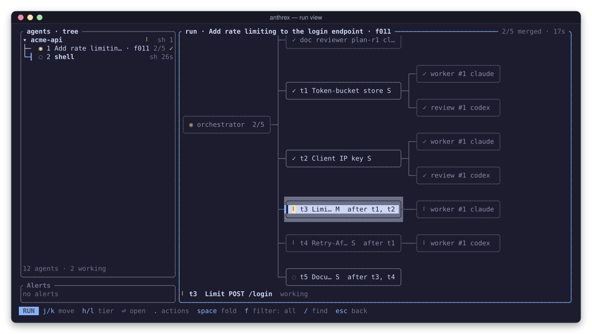</p>

## Why anthrex

Coding agents are good at a focused task and bad at being watched. Run four of them in four terminal tabs and you spend the day switching tabs to find out which one finished, which one is stuck on a permission prompt, and which one is still working. Hand one agent a large goal and you get a large, unreviewed diff.

anthrex fixes both:

- **One screen for every agent.** A background daemon owns a pseudo-terminal per agent and runs the real `claude` or `codex` app (or a shell) inside it. The client shows every agent with its live status from the agent's own hooks, and the focused one at full size. Detach, and the agents keep running; attach again from any terminal.
- **Goals, not prompts.** Give a goal to an orchestrator agent. It brainstorms with two models, writes a spec with numbered requirements, and plans small tasks. You approve each document. Then workers run each task in its own git worktree, a different agent reviews it, and a merge queue tests the merged result. Nothing reaches your branch until you accept it, and in pull-request mode anthrex never merges anything itself.

## Features

| | |
|---|---|
| **Agents side by side** | Real `claude`, `codex` and shell sessions, each in its own PTY, owned by a daemon so they survive closing the UI. |
| **Live status** | Working, waiting for you, done or idle, from each agent's hooks, with the tool it is running and a bell when one of your own agents or a run's orchestrator needs you (a run's workers report to their orchestrator, not to you). |
| **Project tree** | Agents grouped by repository, each with its sub-agents and theirs, drawn with tree connectors to any depth. |
| **Graph overview and inspector** | The same tree as a drawn graph, with a panel that spells out the selected node: model, status, branch, checkout, who spawned it. |
| **Conversation view** | A readable timeline of an agent's turns, built from its hooks and transcript: prose, folded tool calls with diffs, links to sub-agents. |
| **Git at a glance** | Branch, uncommitted work and divergence of the focused agent's checkout, kept fresh by a filesystem watcher. |
| **Worktrees** | Start an agent in a new git worktree on its own branch from the new-agent form or `anthrex new --worktree`. |
| **Persistence** | Windows, names and session ids are saved; after a restart each agent resumes its previous session. |
| **Orchestrated runs** | Goal → design → plan → workers in worktrees → review by a different agent → merge queue → your accept. |
| **Design flow** | Brainstorm (two models, merged), spec (peer-reviewed, numbered requirements), plan (coverage checked by the engine), each behind your approval. |
| **Tiered testing** | Each merge runs the tests it affects, cached by content, with flaky-test handling and a bisect when the full suite goes red. |
| **Stacked-PR delivery** | `pr` mode opens one pull request per stage; CI failures and review comments become fix tasks. You merge. |
| **Keep going** | New rounds on a finished run, and next goals on the same orchestrator. |
| **Tuning** | The run history refits size thresholds, routing and concurrency for the next run, and estimates a run before it starts. |
| **Brakes** | A daemon-wide hold on new sessions (`C-b H`), a quota brake fed by the CLIs' own rate-limit readings, failover to a role's fallback on the other runtime, and a fresh orchestrator session when its context is full. |

### Every agent, with its status

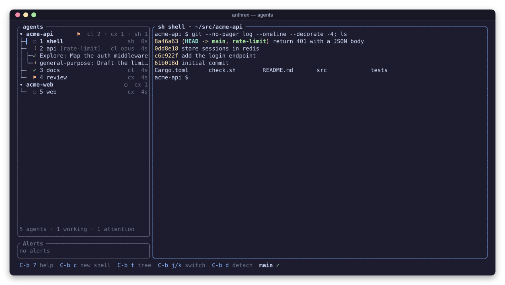

The sidebar groups agents by project. Each row shows the agent's number, status glyph, name, runtime and how long it has been in that state. A worktree agent shows its branch in brackets, and sub-agents hang under the agent that spawned them. The bottom bar shows the focused checkout's branch and whether it is clean.

### The graph overview and inspector

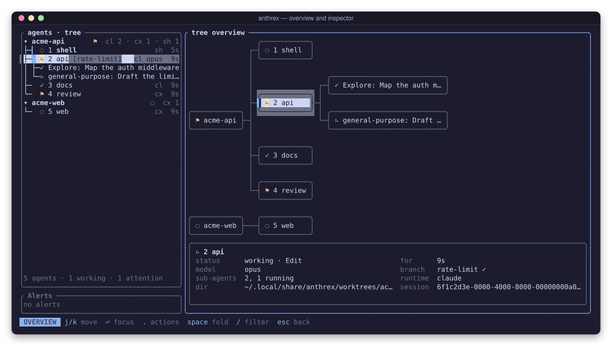

`C-b T` draws the tree as a graph you can pan with the wheel or a drag. The inspector below the canvas describes the selected node; `i` hides it.

### The conversation view

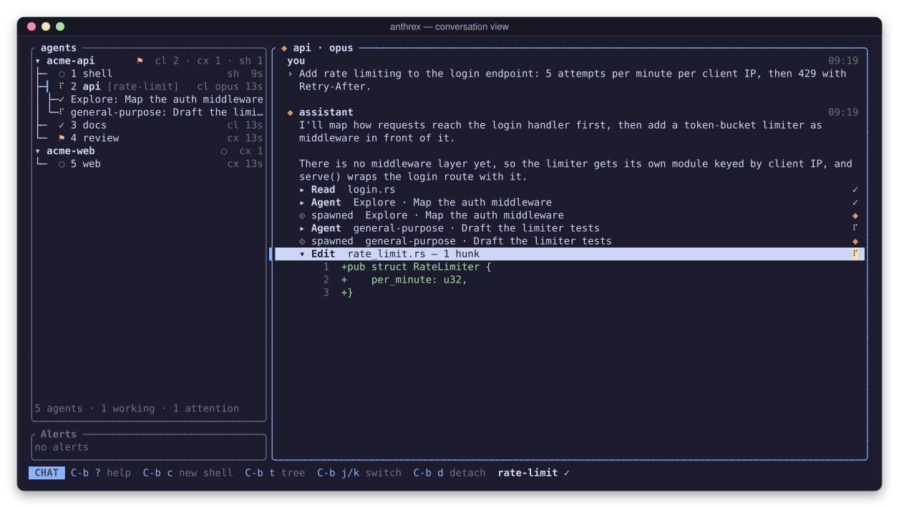

`C-b m` opens the focused agent's conversation: prompts, prose and tool calls, with Enter to unfold a call or open a sub-agent's own conversation, and `/` to search. The view is read-only; you still type to the agent in its terminal.

### New agents and worktrees

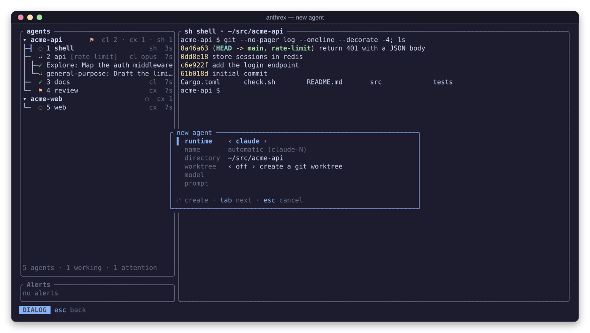

`C-b c` opens the new-agent form. Turn on **worktree** and anthrex creates a git worktree on a new branch and starts the agent there, so several agents can change the same repository without touching each other's files.

## Install

anthrex runs on **macOS and Linux**. You need:

- Rust **1.92** or newer, only to build from source;
- `git`;
- the agents you want to run: [Claude Code](https://docs.anthropic.com/en/docs/claude-code) (`claude`) and/or [Codex](https://github.com/openai/codex) (`codex`), installed and logged in;
- for `pr` delivery only, the GitHub CLI `gh`, logged in.

### From a release

Download a prebuilt binary for Linux (x86_64, arm64) or macOS (Apple silicon, Intel) from the [latest release](https://github.com/danielpina1/anthrex/releases/latest). [docs/install.md](docs/install.md) has the commands, the checksum check, and the macOS quarantine note (the binaries are unsigned).

### From source

Build and install from a clone:

```bash
git clone https://github.com/danielpina1/anthrex.git
cd anthrex
cargo install --path crates/cli     # installs the `anthrex` binary
# or: cargo build --release         # binary at target/release/anthrex
```

## Quick start

```bash
cd ~/src/my-project
anthrex                                       # start the daemon if needed and attach
```

Inside the client the prefix key is `Ctrl-b`, as in tmux. `C-b c` opens the new-agent form; pick Claude, Codex or a shell. `C-b j` / `C-b k` move between agents, `C-b d` detaches and leaves them running, and `C-b ?` shows every key.

From any other shell:

```bash
anthrex new --runtime claude --name api                    # a Claude agent in this directory
anthrex new --runtime codex --worktree fix-login --prompt "fix the flaky login test"
anthrex ls                                                 # every window and its status
anthrex attach api                                         # attach with `api` focused
anthrex daemon stop                                        # stop the daemon and every agent
```

To hand over a whole goal, press `C-b g` on a project in the tree (`C-b t`), type the goal and press `Ctrl-S`; or run:

```bash
anthrex run start --goal "add rate limiting to the login endpoint"
```

## Key bindings

Every command starts with the prefix, `C-b` by default (`prefix` in the config).

| Keys | Action |
|------|--------|
| `C-b j` / `C-b k` (or `n` / `p`) | next / previous agent |
| `C-b 1` … `C-b 9` | focus agent by number |
| `C-b c` | new agent (form) |
| `C-b ,` | rename agent |
| `C-b R` | restart agent, resuming its session |
| `C-b x` / `C-b X` | kill agent / remove agent (and its worktree) |
| `C-b m` | conversation view |
| `C-b t` | tree mode: move, fold and filter the sidebar |
| `C-b T` | overview: the tree as a graph, or an open run's run view |
| `C-b g` | start a goal |
| `C-b a` | alerts: gates, the orchestrator's questions and problems only you can fix; `1`-`9` answers a question |
| `C-b P` / `C-b S` | Profile screen / Settings screen |
| `C-b H` | hold or release dispatch daemon-wide (with a confirm) |
| `C-b s` | toggle the sidebar |
| `C-b <` / `C-b >` | narrow / widen the sidebar |
| `C-b r` | reconnect to the daemon |
| `C-b d` | detach (agents keep running) |
| `C-b Q` | stop the daemon and every agent |
| `C-b C-b` | send a literal `C-b` |
| `C-b ?` | help, opened at the keys of whatever has focus |

Inside a view, bare keys act on it. In the tree and the overview: `j`/`k` move, `h`/`l` go to the parent or child, Enter focuses an agent or opens a run, Space folds, `/` filters, `.` opens the actions for the selected run, stage or task, and `i` toggles the inspector. The help (`C-b ?`) lists the keys of every view: the run view, the plan review, the document gates, the alerts, the conversation, the forms, Profile and Settings.

The mouse works too: click a sidebar row to focus it; the wheel scrolls, or is forwarded to programs that use the mouse. Because the client captures the mouse, use your terminal's Shift-drag to select text. The wheel follows the program in the focused window: a program that turned mouse reporting on gets the wheel in the encoding it asked for (SGR, X10 or UTF-8); a full-screen program without it (`less`, `man`) gets Up and Down arrows, as xterm's alternate scroll does; anywhere else the wheel scrolls the client's scrollback.

**Pasting.** A paste never reaches the focused program with a paste marker (`ESC [200~` or `ESC [201~`) inside its text: anthrex removes them before it adds its own. Where a paste ends is your terminal's call. anthrex receives the paste already cut at the first end marker the terminal sends and cannot join it back, so anything the terminal sends after that marker arrives as typed input. anthrex relies on the terminal to strip or escape an end marker inside the pasted text, as xterm, iTerm2, kitty, WezTerm, Alacritty, Ghostty and VTE-based terminals do.

## The orchestrator

A goal becomes a **run**. One orchestrator agent, the only agent you type to, plans the run through anthrex's MCP tools. Every other agent in a run is headless and watch-only. The engine itself is deterministic: no model merges, approves or writes to your branch.

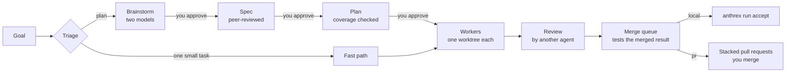

1. **Triage.** A small decider sizes the goal. One small change takes the fast path: a single task, no plan gate. Anything bigger is planned.
2. **Design flow.** For a planned code or docs goal the orchestrator runs three phases, each ending at a gate only you can open:
   - **Brainstorm.** Two models (one Claude, one Codex) explore the goal independently; the orchestrator merges their drafts into one report that shows where they agree and where they disagree.
   - **Spec.** The orchestrator writes a spec with numbered, testable requirements. An independent reviewer reads it, and the disputes the orchestrator kept are shown beside the document.
   - **Plan.** Small tasks, each with a brief, owned files, dependencies, a test mode (TDD where the task needs it) and the requirements it covers. The engine checks that every requirement is covered, and a reviewer checks the plan.

   At each gate you can approve, ask for changes with a note, edit the document yourself, reject, or go back a gate. Turn the flow off per goal (`--design off`, or the goal form's `design` row) or by default in the config.
3. **Work.** Each task runs in its own git worktree with a headless Claude or Codex worker whose model and effort match the task's size. A task passes its test proof, the project's check and a review by a different agent before it merges. Stalls, budget overruns and failures climb an escalation ladder instead of looping.
4. **Merge and test.** A merge queue merges each approved task into the run's integration branch and runs the tests the change affects, cached by content. Flaky tests are retried and proposed for quarantine; a red full suite is bisected to the merge that broke it.
5. **Deliver.** In `local` mode, `anthrex run accept` merges the finished run into your base branch. In `pr` mode, each stage of the plan becomes a stacked pull request; CI failures and review comments from people with write access become fix tasks. anthrex never merges, approves or enables auto-merge: you do.

You watch it all in the **run view** (`C-b T`, then a run): the plan as a graph of tasks by stage, each task's rounds, and an inspector for the selected task. **Alerts** (`C-b a`) collect everything waiting for you, and Enter takes you to it. While a run's orchestrator is alive it handles its run's blocked tasks, halts, held or red stages and delivery problems itself (it retries, overrides, resumes, approves holds and accepts red stages, each with a reason), so what reaches you is an approval or acceptance, a profile proposal, a problem only you can fix (such as a full disk or a logged-out CLI), a question the orchestrator asks with `ask_user` (answer it with `1`-`9`, or in its window), or an orchestrator that has stalled or exited, which hands you back everything it held. What it resolved stays visible quietly as `orchestrator handled N`, with each action and its reason in the run view's inspector.

The run view, the runs tree and `anthrex run status` list every live run and the 50 newest finished runs, newest by start time. Older finished runs stay on disk, untouched, and leave the list; a run id that matches none of the listed runs says `no run matches '<run>' (only the 50 most recent finished runs are listed)` once the list is full.

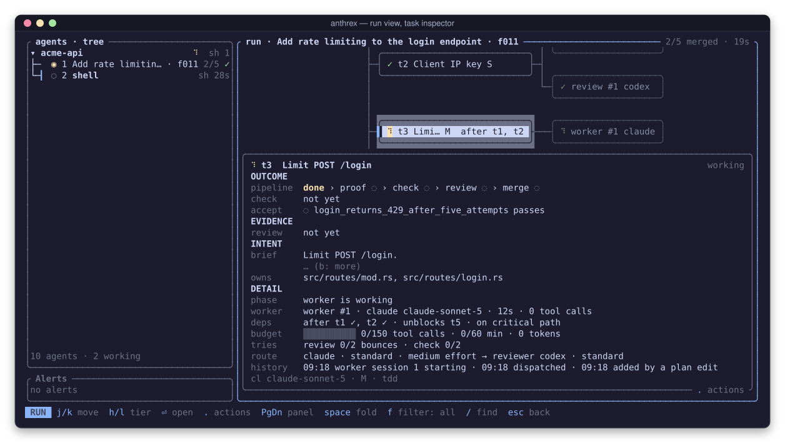

<table>
<tr>
<td width="50%">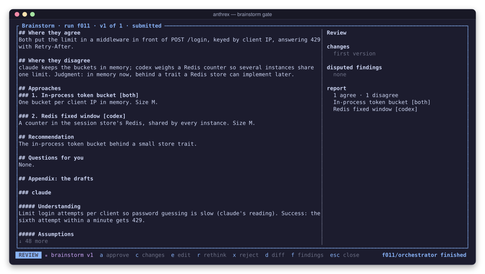<br><sub><b>Brainstorm gate.</b> The merged report, with the drafts appended.</sub></td>
<td width="50%">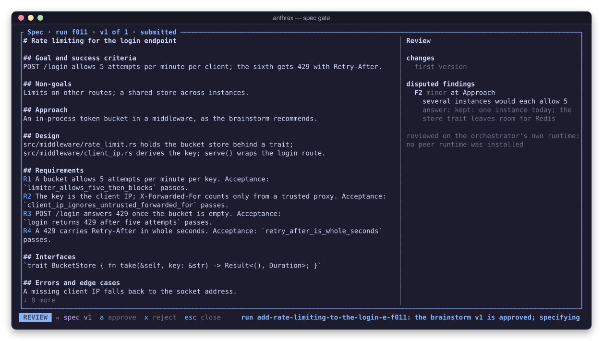<br><sub><b>Spec gate.</b> Numbered requirements; a disputed finding and its answer.</sub></td>
</tr>
<tr>
<td width="50%">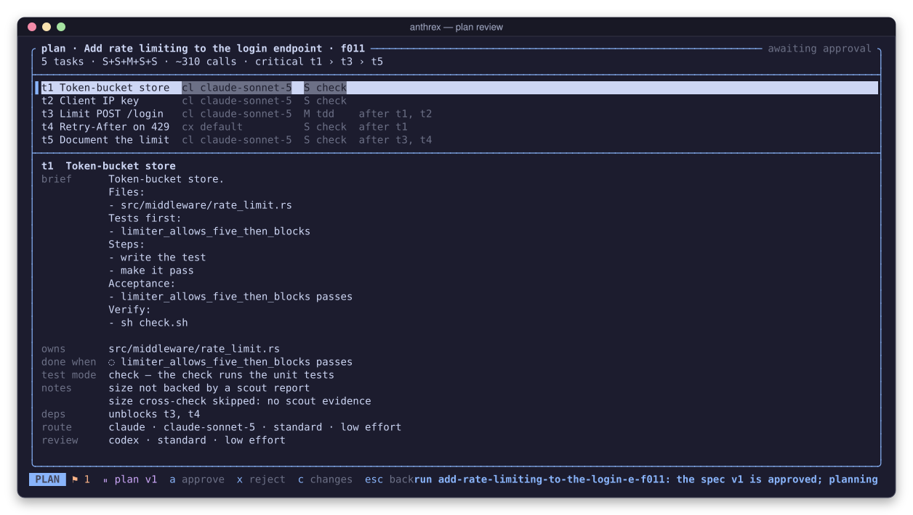<br><sub><b>Plan review.</b> Tasks, routes, dependencies and the critical path.</sub></td>
<td width="50%">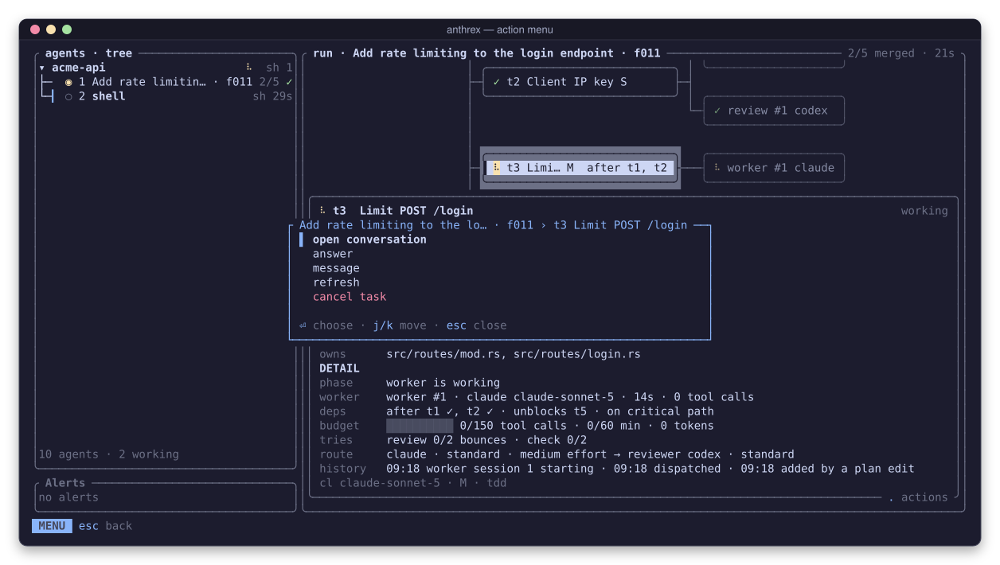<br><sub><b>Actions.</b> What you can do to a run, a stage or a task, computed by the daemon.</sub></td>
</tr>
</table>

### Protected files and the gate's scripts

A run cannot change what judges it, or what runs after it, without you seeing it. A task's `task_done` is refused when its branch changes a protected file that its `owns` does not name exactly, with a line that says why. The 21 built-in protected paths come in two groups:

- **Files that configure or instruct future agents:** `.claude/**`, `.mcp.json`, `.codex/**`, `**/CLAUDE.md`, `**/AGENTS.md`, `**/AGENTS.override.md`, `**/CLAUDE.local.md`, `.agents/**`.
- **Files that run outside the run's sandbox later** (CI, git hooks, cargo and toolchain configuration): `.github/workflows/**`, `.github/actions/**`, `.gitlab-ci.yml`, `.circleci/**`, `.buildkite/**`, `Jenkinsfile`, `azure-pipelines.yml`, `.githooks/**`, `.husky/**`, `.pre-commit-config.yaml`, `**/.cargo/**`, `**/rust-toolchain`, `**/rust-toolchain.toml`.

Add your own with `protected` in the profile (`[orchestrator.profile]` or a plan's `[profile]`); nothing removes a built-in one. `Cargo.toml`, `build.rs`, `package.json`, `pyproject.toml` and `go.mod` are not built in.

**The gate's own scripts are pinned.** At the start of a run, anthrex reads which tracked files the profile's commands name (`check`, `setup`, `single_test` and the tier commands; `make` adds its `GNUmakefile`, `makefile` and `Makefile`, `just` its `justfile`, `Justfile` and `.justfile`, `tox` its `tox.ini`, `nox` its `noxfile.py`). Those files are protected too, and so is each of those names that the program would prefer over the one the base commit has, or every one of them when it has none: such a name is pinned as absent, so a task that creates it (a `GNUmakefile` beside the tracked `Makefile`, say) is bounced unless its `owns` names it exactly, and a gate command refuses a checkout where it appeared. `pyproject.toml`, `setup.cfg` and `package.json` are never added. Before every gate command anthrex compares the pinned files in the checkout with the base commit. If a run changed one, the command never runs: the run halts with `the gate's script <path> differs from the base commit's; the run changed what measures it`, and only you can resume it. To let a task change a gate script, name the script exactly in that task's `owns`; you approve that grant with the plan (the plan review notes it), and the file is then not pinned for that run. Your own `anthrex run override` of a task that changes a pinned script lets the change through `task_done`, but its reply says the script `stays pinned until a task's owns names it (run edit)`: the next gate command halts the run until a task whose `owns` names the script is added with `anthrex run edit`, after which `run resume` (and a second override of the task) carries on.

**What the orchestrator may not do.** It cannot override a task whose branch changes a protected file its `owns` does not name, approve a hold whose tasks name a protected file, or add such a task outside a hold after the plan gate: those go to you. After it has retried one task twice, that task's next block is yours. Once it has read text from outside the run (a pull-request comment, or a review or CI fix task's block, note or result), its `override` and `accept_red` become an `orchestrator asks` question to you (`do it` / `leave it`), and its `approve_hold` is refused, for the rest of the run and any next goal it continues. `anthrex run status` and the run view's inspector show `untrusted text read: <source> at <HH:MM>`.

### Keep going and tuning

- **Rounds.** `anthrex run iterate <run> "<request>"` (or the action menu) asks the orchestrator to plan a new round of a complete run; a design run amends its spec first.
- **Chains.** `anthrex run start --goal ... --continue <run>` plans a next goal with the same orchestrator, which keeps its context.
- **Repository profile.** How anthrex builds, checks and tests a repository. You do not set it up first: a first goal in a repository with no profile waits while a read-only scout proposes the check and test commands and anthrex verifies them (the Alerts box shows `setting up anthrex`, then `review how anthrex will work here`). Enter opens one review card, and **Use this** stores the profile and starts the waiting goals; `anthrex profile use` (or its alias `anthrex profile confirm`) does the same from the CLI. `anthrex run start --goal` there exits with status 3 and nothing on stdout, since no run has started yet. `anthrex profile detect` sets a repository up, or detects again, without a goal.
- **Profile screen.** `C-b P` is one page: a status line (`Ready · verified 2h ago`, `Needs review`, `Out of date — … changed`, `Not set up — press d to set up`), then How anthrex checks your work, Your repo and Delivery, in plain labels with each key dimmed beside it, and `Advanced ▸` folded (`a` opens it). `e` edits a row: a command is checked once, then saved on ✓; on ✗ the row says why, `o` shows the output, `s` saves it anyway and `r` reverts. On the review card the same edit changes only the proposal until **Use this**. From the CLI, `anthrex profile edit <key> <value> --yes` stores an edit once its check passes, and `--anyway` stores it whatever the check finds. Edits wait while a run is live in the repository.
- **History.** Every run is recorded. `anthrex run stats` summarises it by task class, and new runs start from what the history learned: size thresholds, concurrency and a run estimate. Settings (`C-b S`) shows and edits the models each role runs (below) and the limits.

### Lessons

anthrex learns from the outcomes of its own runs in a repository, and hands what it learned to the next workers as advisory notes. Everything is kept per repository in the daemon's data directory (`lessons.jsonl`, next to `history.jsonl`), never in your repository.

- **What is recorded.** Every failed check or proof leaves a failure signature (a normalised fingerprint of its output) on the task's history record, with no model involved. A signature seen in at least two runs within 14 days becomes a *known failure*; it ends after five clean runs over the same files, after 90 days, or when you dismiss it. When a task recovers from a failure, ends blocked or meets a blocking review, or a run fails or is discarded, a background distiller (one decider call, off the run, at most 20 a day per repository) reads a redacted dossier of what happened and proposes up to a few lessons: an *episodic* lesson (what went wrong here) goes on trial at once; a *procedural* or *semantic* one (how to work here) waits for your approval as `proposed`. A lesson earns credit by outcome: each task that was shown it and merged (and was not reverted) counts green.
- **Where lessons go.** Proposed lessons are never used. At the start of a run, the active lessons are frozen into it. Each worker's first turn gets at most five, chosen by how well their files match the task's `owns`, by usefulness and by recency, under the heading `Notes from earlier runs in this repository. They are advisory; your task and its acceptance criteria above take precedence.` Its reviewer gets the same ones under `Known pitfalls in this repository`. Before a review, a reviewer can also get a short risk note written from the task's brief alone (`risk_note`).
- **Discard reason.** `anthrex run discard <run> --reason "<text>"` (or the TUI's discard form) records why you threw a run away; the reason goes on the run's history record and into the distiller's dossier.
- **The CLI.** `anthrex lessons list [--all] [--json]` lists the repository's lessons (`--all` adds rejected and retired ones) with their status, layer and `green/outcomes`. `anthrex lessons approve <id>…`, `reject <id>…` and `forget <id>…` decide or remove lessons (a known failure is forgotten by dismissing it); each asks `y/N` per id unless `--yes`. An id may be shortened to a unique prefix of six or more characters.
- **The Profile screen's Lessons page.** `C-b P`, then `l` (the hint says how many lessons wait for review): one row per lesson with its status glyph, layer and credit, the selected lesson's body and files below. `a` approves, `r` rejects and `d` forgets (each of the last two asks `y/n`), `t` shows rejected and retired lessons too, `Esc` goes back.
- **The knowledge graph page.** `g` on the Lessons page draws the repository's lessons as a graph: a hub `◉` per module (from the module graph cache, else the profile's `modules`) and one `(root)` hub, a dot `•` per lesson (a hollow `○` while proposed), linked to the modules their files touch, to lessons that share files, and to the known failure they were distilled from. Arrows move the selection, `Enter` opens an inspect panel, `/` searches, `+`/`-` zoom, `hjkl` pan, `0` recentres, `a`/`r` approve or reject, `d` forgets or dismisses, and `Esc` returns to the Lessons page.

The `[lessons]` table (every key optional; the daemon reads it at start):

```toml
[lessons]
enabled = true              # lessons in worker and reviewer prompts, and distillation
distill = true              # ask the distiller after a recovered task or a discard
risk_note = true            # a pre-review risk note from the brief alone
max_items = 5               # lessons per prompt (1 to 10)
block_chars = 4000          # the prompt block's size (500 to 20000)
item_chars = 600            # one lesson's size (100 to 2000)
dossier_chars = 12000       # the distiller's dossier (2000 to 50000)
episodic_trial_runs = 20    # runs an episodic lesson stays on trial
known_min = 2               # runs a signature needs to become a known failure
known_window_days = 14
known_clean_runs = 5        # clean runs that end a known failure
expiry_days = 90
max_distills_per_day = 20   # per repository; 0 stops the distiller
```

With `enabled = false` no prompt carries a lessons block and nothing is distilled; failure signatures are still recorded, since they are history. The distiller and the risk note are decider calls, so they follow `[orchestrator] deciders` (with the deciders off, nothing is distilled).

### Brakes

anthrex keeps runs from spending a subscription it cannot see and lets you stop everything new at once. None of it reads a credential or calls a vendor: each runtime's quota comes from what its own CLI already writes.

- **The hold.** `C-b H` (with a confirm) or `anthrex hold on` stops new work daemon-wide: no task, planner, scout or goal starts a fresh session. Work already started (a running session, its review, fix rounds and merge) finishes, and runs stay running. The status bar shows ` HELD `, an alert and each run's attention line say `dispatch is held daemon-wide · anthrex hold off`, a new goal is refused with that text, and a queued goal waits. The hold is saved in the data directory (`brakes.json`) and survives a restart; `C-b H` again or `anthrex hold off` releases it and says how many queued goals now start. `anthrex hold status` prints the hold and each runtime's quota. The hold fails closed: a `brakes.json` that does not parse is moved aside to `brakes.json.corrupt-<unix>` and the daemon starts held (`by: corrupt brakes.json`), with that hold written back so a restart stays held; one that cannot be read in time also starts held (`by: unreadable brakes.json`) and is left as it is. `anthrex hold off` clears it, which saves `brakes.json` afresh: while the data directory is not writable the release is refused (`the hold was not saved: …`) and the hold stays.
- **The quota brake.** Claude's stream reports its 5-hour and 7-day usage (`rate_limit_event`); Codex's session rollout under `$CODEX_HOME/sessions` reports its windows (`token_count`). When a runtime's 5-hour window reaches 90 % or its 7-day window 95 %, no new session of that runtime starts until the window resets: `claude dispatch held: 7d at 97% (≥95%) until 14:30 UTC`. Work already in flight finishes. A trip holds until its window resets or a newer reading of that window comes in below the threshold; it never lifts because its reading went stale, since a braked runtime starts no session that could report a new one. Only a runtime with no trip fails open: with no reading in the last 10 minutes (`quota_fresh_secs`) it is not braked, and the run log says once that it is unmeasured.
- **Failover.** A new session whose runtime is braked starts on its role row's "if it struggles" fallback when that is on the other runtime, and the run says `claude braked: t2 started on codex (fallback)`. A reviewer never gets its author's model, two runtimes never share overlapping files, and the hold stops failover too. To keep a role on one subscription, give its row a fallback on the same runtime.
- **The context handoff.** When you continue a goal on a chain whose orchestrator session is 80 % of its context window, or 300,000 tokens, full, a fresh orchestrator session starts with the previous goal's summary and history and says how full the old one was; the old window stays, renamed `<h4>/orchestrator (handed off)`. A live orchestrator at 90 % gets an attention line.

```toml
[orchestrator]
handoff_at_percent = 80       # 0 turns this criterion off
handoff_at_tokens = 300000    # 0 turns this criterion off
context_window_tokens = 0     # 0: the session's own window, else 200,000

[orchestrator.brakes]         # also on the Settings screen (C-b S), applied live
quota_brake = true
quota_pause_5h_percent = 90
quota_pause_7d_percent = 95
quota_fresh_secs = 600        # how long a reading counts
```

## Configuration

anthrex reads `config.toml` from `~/Library/Application Support/anthrex/` on macOS and `~/.config/anthrex/` on Linux, or from `ANTHREX_CONFIG`. Every key is optional. An invalid or unknown key is reported and keeps its default; it never stops anthrex from starting. The Settings screen (`C-b S`) edits the file and applies most changes live.

```toml
prefix = "C-b"              # Ctrl plus a letter (not h, i, j or m)
accent = "#89b4fa"          # accent colour under truecolor
default_runtime = "shell"   # claude | codex | shell, for `anthrex new` without --runtime
scrollback_lines = 5000

[bell]
attention = true            # ring when your agent or an orchestrator needs you
done = false                # ring when an agent finishes

[ui]
sidebar_width = 40          # 24 to 60
tree_keep_finished_secs = 300

[runtimes]
claude.command = "claude"
codex.command = "codex"

[git]
enabled = true              # the bottom bar's git segment and its watcher
poll_secs = 30              # the safety poll behind the watcher

[theme]
truecolor = "auto"          # auto (from COLORTERM) | on | off

[orchestrator]
max_writers = 3             # tasks writing at once
max_readers = 3
worker_sandbox = true

[orchestrator.design]
default = "full"            # full | off, for goals the design flow applies to
docs_dir = "docs/anthrex"   # where approved specs and plans are committed; "" = never
max_questions = 5

[testing]
test_slots = 4              # test commands at once (default: cores minus 2)

[delivery]                  # pr mode: how stage pull requests are watched
poll_secs = 60
ci_fix_max = 2
review_fix_max = 3
```

Other tables: `[conversation]` (the conversation view's limits and runtime badges), `[panes]` (accepted for compatibility and ignored; split panes were dropped), and under `[orchestrator]`: `budget`, `review`, `claude`, `deciders`, `scouts`, `onboarding`, `metering`, `planners` and `tuning`. `[orchestrator.onboarding] auto` decides only whether a stale profile is detected again on its own; a goal in a repository with no profile sets it up either way. The delivery mode (`local` or `pr`) and remote are per repository, in its profile: `anthrex profile edit`.

### Models

Every model anthrex launches comes from one table, `[models]`: one row per role. A row names a `model` as `<runtime>:<model id>`, an optional `effort`, and an optional `fallback`, the model to switch to if the task struggles. A row you leave out keeps its built-in model.

```toml
[models.implementer.small]
model = "claude:claude-sonnet-5"
effort = "low"
fallback = "codex:default"      # the model Codex is set to use

[models.reviewer]
model = "codex:gpt-6-sol"
effort = "high"

[models.helpers.triage]         # one helper; the others follow [models.helpers]
model = "claude:claude-haiku-4-5"

[models.brainstorm]             # the design flow's two brainstormers
first = "claude:claude-opus-5-5"
second = "codex:default"
```

- **Rows.** `orchestrator`, `planner`, `implementer.small`, `implementer.medium`, `implementer.hub`, `test_writer`, `reviewer`, `research`, `helpers` (with `helpers.run_name`, `triage`, `size_check`, `check_summary`, `blocked_reason` and `ci_summary` to set one helper apart) and `brainstorm`. The orchestrator gives each task a size; the size picks the row. It never picks a model.
- **`codex:default`** (or `claude:default`) runs the CLI's own configured model, with no `-m` or `--model`.
- **Effort.** A task that struggles runs again at its model's next higher effort, up to the highest the CLI offers, then on the row's `fallback` (climbing its efforts too), then stays there. anthrex never switches to a model you did not name.
- **Per repository.** `<data dir>/repos/<repo>-<hash>/models.toml` holds the same `[models.*]` rows for one repository. A row there replaces the global row whole; a row it leaves out comes from `config.toml`, then the built-in.
- **Older configs.** The old keys (`[[orchestrator.models]]`, `[orchestrator.routes.*]`, `[orchestrator.agent]`, `default_runtime` and `builtin_models` under `[orchestrator]`, the `strength`, `runtime` and `effort` of `planners` and `scouts`, and the `strength` and `effort` of `deciders`) are read as the same rows, so every role keeps its model. The file is rewritten only when you save in Settings: the old keys are removed, and each save that removes any keeps the previous file as `config.toml.bak`, or as `config.toml.bak.1`, `.2` and so on when that name is taken (an existing backup is never replaced). A save is refused when `config.toml` changed after the daemon read it, so a hand edit is never reverted: restart the daemon or reopen `C-b S`, then save again.
- **Kept keys.** A key that gave no row is kept on save, along with the roster and `default_runtime` it is read against: a list none of whose models anthrex knows, a review list none of whose models can review the other runtime's work, or a route it could not migrate. The daemon's log has a note naming the row and the model it uses meanwhile. Choose that row's model in Settings and save to remove it.

In Settings (`C-b S`), the `models` section shows the table. `j`/`k` move between rows (Space opens or closes the `helpers` kinds). `⏎` picks the row's model from the list the installed `claude` and `codex` report (or `custom…` for any id; `r` in the list asks the CLIs again), `e` cycles its effort, `f` picks its fallback, `x` resets the row, `←`/`→` switch between `everywhere` (`config.toml`) and `this repo` (`models.toml`), and `w` saves. Runs in progress keep the models they started with.

Environment variables:

| Variable | Effect |
|----------|--------|
| `ANTHREX_SOCKET`, `ANTHREX_DATA_DIR`, `ANTHREX_CONFIG` | Override the socket, the data directory and the config file. |
| `ANTHREX_GIT=off` | Disable the git watcher and probes. |
| `ANTHREX_LOG=debug` | Raise the daemon's log level. |
| `ANTHREX_CHECK_ENV_PASS=NPM_TOKEN,GH_TOKEN` | Read from the daemon's own environment: the token variables checks may still see (below). |

| File | macOS | Linux |
|------|-------|-------|
| socket | `$TMPDIR/anthrex-<uid>/daemon.sock` | `$XDG_RUNTIME_DIR/anthrex/daemon.sock` |
| log, state, runs, worktrees | `~/Library/Application Support/anthrex/` | `~/.local/share/anthrex/` |

### Environment and isolation

- **Your own agent windows keep your environment.** A `claude` or `codex` window you start yourself (`C-b c`, `anthrex new`) inherits the environment of the shell that started the daemon, as a shell would, `CLAUDE_CODE_*`, `MCP_*` and `OTEL_*` included. That covers `CLAUDE_CODE_CHILD_SESSION`, which turns Claude Code's transcript saving off, and Claude Code's messaging socket (`CLAUDE_CODE_MESSAGING_SOCKET` and its token): a daemon started from inside a Claude Code session hands them to every window you open. Start the daemon from a plain shell if you do not want that. anthrex's own sessions (the orchestrator, workers, reviewers, scouts and deciders) do not inherit them.
- **Checks do not see your tokens.** anthrex runs checks, proofs, `setup` and tier steps without these variables from the daemon's environment: `GITHUB_TOKEN`, `GH_TOKEN`, `GH_ENTERPRISE_TOKEN`, `GITLAB_TOKEN`, `NPM_TOKEN`, `NODE_AUTH_TOKEN`, `PYPI_TOKEN`, `CARGO_REGISTRY_TOKEN`, `HF_TOKEN`, `DOCKER_PASSWORD`, and every variable starting with `AWS_`, `AZURE_`, `GOOGLE_APPLICATION_CREDENTIALS`, `CLOUDSDK_` or `DIGITALOCEAN_`. If a check needs one, list it, comma-separated, in `ANTHREX_CHECK_ENV_PASS` in the daemon's own environment, then restart the daemon: `ANTHREX_CHECK_ENV_PASS=NPM_TOKEN,GH_TOKEN anthrex daemon start`. Only exact names are passed. A check that fails for a missing token says so in its own output. Agent sessions are not affected.
- **`worker_sandbox = false` gives workers your full power.** An unsandboxed worker runs as you: it can read the arguments and environment of any of your processes, so it can act as any anthrex session, including approving its own task's review. Keep the default, `true`, unless you trust every worker with that.
- **What a crash can leave running.** When the daemon restarts after a crash, it stops a leftover agent session only when anthrex itself recorded the session's process id (in the run's file or its journal) and the process's arguments name the session. Two kinds are not found, because finding them would mean inspecting processes anthrex did not start, which it never does: **Codex's first process** (its arguments carry no session id) and **a process that left its session's process group with `setsid`**. A `setsid` descendant also keeps its sandbox grant, the files its worker was allowed to write, for as long as the daemon runs, even after its task has moved on. After a crash, check `ps` for leftover `codex` processes or processes a worker detached.

## CLI reference

`anthrex` with no command attaches (and starts the daemon if needed). Every command takes `--dir <DIR>`, the directory new agents start in, and `--help`.

| Command | What it does |
|---------|--------------|
| `anthrex attach [TARGET]` | Attach, focusing a window by id or name. |
| `anthrex new [--runtime claude\|codex\|shell] [--name N] [--worktree BRANCH] [--model M] [--prompt P]` | Create a window and print its id. |
| `anthrex ls [--json]` | List windows. |
| `anthrex tree [--project DIR] [--json]` | Print the project tree. |
| `anthrex rename <TARGET> <NAME>` | Rename a window. |
| `anthrex restart <TARGET>` | Restart a window, resuming its session when known. |
| `anthrex kill <TARGET>` | Kill a window's process group (SIGHUP, then SIGTERM, then SIGKILL). |
| `anthrex rm <TARGET> [--worktree [--force]]` | Kill and forget a window; optionally remove its worktree (the branch is kept). |
| `anthrex daemon start [--foreground] \| stop \| status` | Manage the background daemon. |
| `anthrex profile status \| detect \| show \| use \| reject \| edit` | Detect, show, use (store; `confirm` is its alias) and correct the repository's profile; `edit --anyway` stores an edit whatever its check finds. |
| `anthrex run <subcommand>` | Start, watch and finish orchestrated runs (below). |
| `anthrex lessons list [--all] [--json] \| approve \| reject \| forget <ID>… [--yes]` | List the repository's lessons, approve or reject proposed ones, forget a lesson or dismiss a known failure. |
| `anthrex hold on \| off \| status` | Hold or release dispatch daemon-wide, or show the hold and each runtime's quota. |

`anthrex run` subcommands:

| Subcommand | What it does |
|------------|--------------|
| `start --goal G \| --plan FILE` | Start a run from a goal or a plan file and print its id. Options: `--design full\|off`, `--delivery pr\|local`, `--orchestrator RUNTIME[:MODEL]`, `--continue RUN`, `--yes`, `--trust-project`, `--unconfined-checks`. |
| `status [RUN] [--json]` | Show every run, or one. |
| `approve RUN [--gate brainstorm\|spec\|plan] [--hold H]` | Approve a plan, a design gate or a hold. |
| `reject RUN` | Reject a plan, or cancel a hold. |
| `show`, `changes`, `edit-doc`, `rethink`, `back` | Read a design document, ask for changes, edit it yourself, brainstorm again, or go back a gate. |
| `edit RUN --file FILE` | Apply a file of plan edits. |
| `message RUN TO TEXT`, `refresh` | Message a task's worker, delivered when its turn ends; merge the run's latest work into a task's branch. |
| `retry`, `override`, `cancel`, `resume` | Retry a task, merge a task without its review's approval, cancel or resume a run. |
| `iterate RUN TEXT` | Start a new round of a complete run, which its orchestrator plans. |
| `promote RUN` | Turn a fast-path run into a planned run with an orchestrator. |
| `prs RUN`, `deliver`, `watch` | `pr` mode: show each stage's pull request, deliver a stage now, stop or resume watching. |
| `accept RUN`, `discard RUN [--reason TEXT]` | Merge a complete run into its base branch, or discard it (the reason goes on its history record). |
| `stats` | Summarise this repository's run history by task class. |

## Architecture

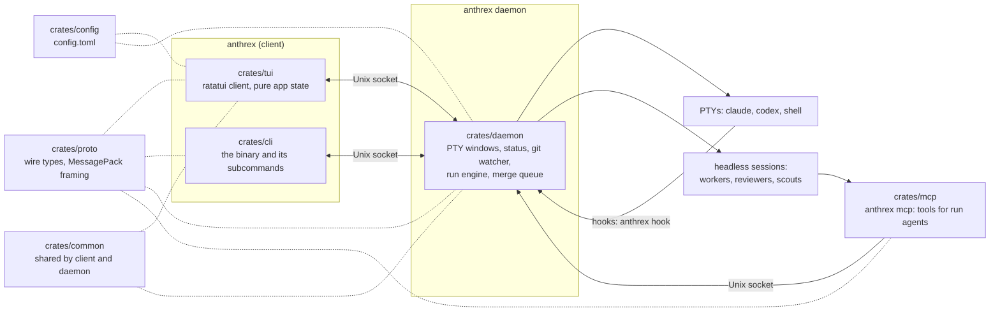

- **`crates/daemon`** owns one pseudo-terminal per window and parses each agent's hooks into a status state machine. It also runs the orchestration engine: the task graph, headless sessions, gates, the merge queue and the journal. Blocking work (git, process spawns, file I/O) never runs under its locks.
- **`crates/tui`** is the client. Its application state is pure: key handling returns effects, and rendering only reads the state.
- **`crates/common`** holds what the client and the daemon share without the client depending on the daemon (lock and log files, refusal texts, labels, branch syntax, worktree names), so an engine edit never rebuilds the client.
- **`crates/proto`** holds the wire types and the length-prefixed MessagePack framing that every client shares, with a protocol version checked at the handshake.
- **`crates/mcp`** serves the MCP tools that the orchestrator, workers, reviewers and scouts call (`anthrex mcp`, started by the daemon).
- **`crates/config`** parses `config.toml`. **`crates/fake-agent`** is a scripted stand-in for `claude` and `codex` that the tests use.

## Development

```bash
cargo build --workspace --all-targets
cargo nextest run --workspace     # cargo install cargo-nextest --locked --version 0.9.146
cargo test --workspace --doc
cargo clippy --workspace --all-targets -- -D warnings
cargo fmt --all --check
python3 scripts/pty-smoke.py      # drives the real binary through a PTY, end to end
```

The tests never run a real agent: they use `crates/fake-agent`. The smoke test runs its own daemon on an isolated socket and data directory under `/tmp`. The screenshots in this README come from the real client, driven the same way; [`docs/screenshots.md`](docs/screenshots.md) explains how to regenerate them.

## Roadmap

[`docs/ROADMAP.md`](docs/ROADMAP.md) lists every milestone, its brief and its status.

## Contributing

Contributions are welcome. [`CONTRIBUTING.md`](CONTRIBUTING.md) covers the build, the tests-first rule, commit style and the pull request flow. Coding agents working on this repository start with [`AGENTS.md`](AGENTS.md).

## License

[MIT](LICENSE) © 2026 Daniel Pina
